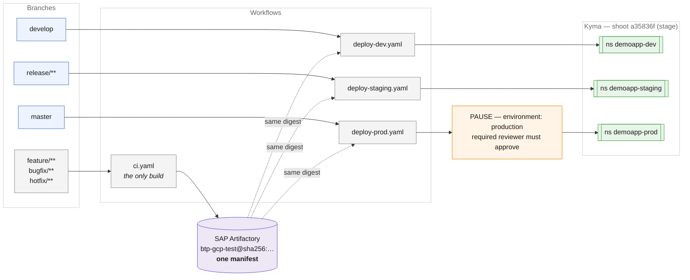
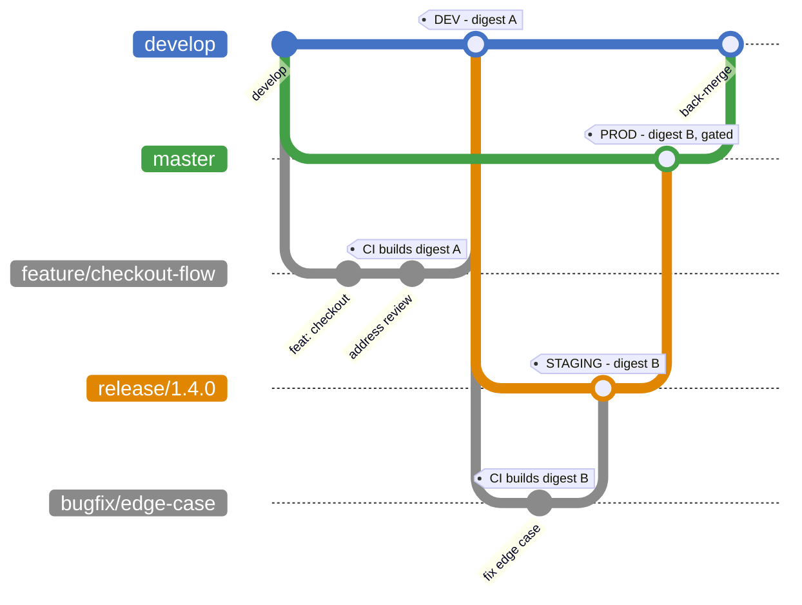
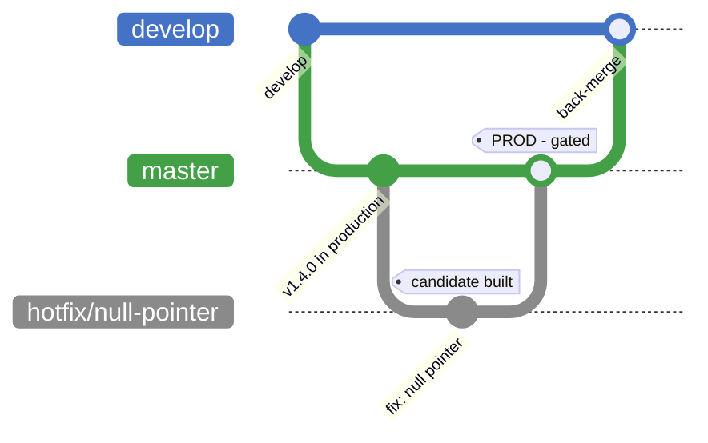

# Branching Strategy & CI/CD

The branching model follows the SAP promotion-branch pattern, suited to Hyperspace's
environment-pinned, gated deployments. Branches map to environments; a single image
digest built from a feature branch is promoted by reference rather than rebuilt.

This document describes the pipeline as implemented. Section
[Limitations](#limitations) records where the implementation stops short.

## 1. The contract

| Branch | Maps to | Behaviour |
|---|---|---|
| `master` | Production (Kyma) | Protected. Merge triggers prod deploy behind a required reviewer. Only `release/**` and `hotfix/**` merge in. |
| `release/**` | Staging / pre-prod (Kyma) | Cut from `develop`. Hardening and fixes only — no new features. Deploys to staging. |
| `develop` | Dev (Kyma) | Integration branch. Auto-deploys to dev on merge. |
| `feature/**` | CI only — no deploy | Short-lived off `develop`. PR back into `develop`. Builds, tests, scans, pushes candidate image to SAP Artifactory. |
| `bugfix/**` | CI only — no deploy | Same as `feature/**`. Used off `release/**` for hardening. |
| `hotfix/**` | CI only — reaches prod via `master` | Off `master` for urgent fixes. Merged into `master`, then back into `develop`. |



## 2. Promotion flow

`feature/** → develop (dev) → release/** (staging) → master (prod)`. Build once;
promote the same SAP Artifactory digest across environments — only Helm values
(per-environment) change.

- **Build** — `ci.yaml` runs on feature, bugfix and hotfix branches and on every PR.
  It runs tests and dependency/container scans, then pushes a candidate image to SAP
  Artifactory tagged `candidate-<commit sha>`. **This is the only workflow that builds
  an image.**
- **Promote** — `wf-promote.yaml` resolves that candidate's digest, adds an
  environment tag to the *same manifest* with `docker buildx imagetools create` (a
  registry-side reference, no pull and no rebuild), and deploys it with
  `helm upgrade --set image.digest=sha256:…`.
- **Pin** — the chart renders `registry/btp-gcp-test@sha256:…`. It refuses to render a
  digest that is not `sha256:`-prefixed, and refuses to render at all if neither digest
  nor tag is supplied, so an unqualified image can never reach a cluster.

There is no build step in any deploy workflow. If the candidate cannot be resolved the
promotion **fails** rather than falling back to a rebuild, which is what keeps the
build-once guarantee honest.

### How the digest is found

The commit on `develop`/`release/**`/`master` is usually not the commit that was built.
`scripts/resolve-candidate-digest.sh` tries, in order:

1. the pushed commit itself — fast-forward merges;
2. every commit the push carried — "Create a merge commit" merges;
3. the head commit of the PR named in the commit subject — squash and rebase merges;
4. a walk back through history — **only when the push carried no commits at all**.

Step 4 is what covers cutting a `release/**` branch, which creates a branch with no
new commits: walking back reaches the merge commit's second parent, which is the topic
branch head where the candidate was built.

It is deliberately gated. If the push *did* carry commits and none of them has a
candidate, the promotion fails instead of walking back — an older candidate would mean
silently deploying an image that is not the code on the branch.

Which path each event takes:

| Event | Resolves via |
|---|---|
| PR merged into `develop` (merge commit) | step 2 |
| PR squashed or rebased into `develop` | step 3 |
| `cut-release.sh` creates `release/x` | step 4 |
| `bugfix/**` PR merged into `release/x` | step 2 |
| `hotfix/**` PR merged into `master` | step 2 |
| `release/x` merged into `master` | step 2 |
| commit pushed **directly** to `release/x` | **fails** — no candidate exists |

If nothing resolves, the script exits non-zero with instructions to re-run CI on the
source branch.

## 3. Scenario — a normal release



1. `feature/checkout-flow` off `develop`. CI builds **digest A** and publishes it.
2. PR merged into `develop` → dev promotes digest A. Nothing is rebuilt.
3. `./scripts/cut-release.sh 1.4.0` cuts `release/1.4.0` from `develop`.
4. Hardening goes through `bugfix/edge-case` off the release branch, so CI builds
   **digest B**. Merging it into `release/1.4.0` promotes digest B to staging.
5. `./scripts/promote-to-prod.sh 1.4.0` merges the release into `master`. Production
   promotes **the same digest B** that staging verified, after a reviewer approves.
6. Merge `master` back into `develop`.

Hardening must go through a `bugfix/**` branch. A commit pushed directly to
`release/**` has no candidate image, so the promotion fails by design — see
[Limitations](#limitations).

## 4. Scenario — an urgent hotfix



```bash
./scripts/cut-hotfix.sh null-pointer     # hotfix/null-pointer off master
# commit the fix, let CI publish the candidate, PR into master
# merging master deploys prod (gated)
git checkout develop && git merge --no-ff master && git push origin develop
```

The hotfix branch does not deploy to production itself. It reaches production by being
merged into `master`, which is the only branch wired to the prod environment.

## 5. What a promotion job does

Every environment runs the same `wf-promote.yaml`, differing only in values file,
namespace, timeout and whether the approval gate applies:

1. checkout, then fail fast on unfilled placeholders in the values file
2. log in to Artifactory
3. collect candidate commits, resolve the candidate **digest**
4. `docker buildx imagetools create` — tag that digest for this environment
5. load the kubeconfig, create the namespace and pull secret idempotently
6. `helm upgrade --install --atomic --set image.digest=…`
7. wait for the APIRule, then smoke-test the public host

Failure behaviour is not uniform, and this matters:

| Step that fails | Effect on the running service |
|---|---|
| Digest resolution | Nothing deployed. Promotion stops before touching the cluster. |
| `helm upgrade --atomic` | Helm reverts automatically; previous release stays live. |
| `wait-apirule-ready.sh` | Job red, **but the new release stays deployed.** |
| `smoke-test.sh` | Job red, **but the new release stays deployed.** |

`--atomic` only covers the Helm operation. A chart that installs cleanly but never
becomes reachable leaves a broken release live, and a human decides:

```bash
helm history hello-world -n demoapp-prod
helm rollback hello-world <revision> -n demoapp-prod --wait
```

## 6. Reference

### Triggers

```yaml
# ci.yaml           - the only build
pull_request: [develop, master, 'release/**']
push:         ['feature/**', 'bugfix/**', 'hotfix/**']

# deploy-dev.yaml       push: [develop]
# deploy-staging.yaml   push: ['release/**']
# deploy-prod.yaml      push: [master]        + environment: production
```

Every workflow also has `workflow_dispatch`.

### Environments

| | dev | staging | prod |
|---|---|---|---|
| Branch | `develop` | `release/**` | `master` |
| Namespace | `demoapp-dev` | `demoapp-staging` | `demoapp-prod` |
| Values | `values-dev.yaml` | `values-staging.yaml` | `values-prod.yaml` |
| Host | `demoapp-dev.a35836f.stage.kyma.ondemand.com` | `demoapp-staging.a35836f.stage.kyma.ondemand.com` | `demoapp.a35836f.stage.kyma.ondemand.com` |
| Replicas | 1 | 1 | 2 |
| Helm timeout | 3m | 3m | 5m |
| Approval gate | no | no | **yes** |

All three share one Kyma cluster (shoot `a35836f`, stage) and one image repository,
`gtlc-production.common.repositories.cloud.sap/btp-gcp-test`. One repository is a
requirement, not a convenience: a digest is only meaningful within a repository.

### Secrets

| Secret | Purpose |
|---|---|
| `GCP_KUBECONFIG_B64` | base64 kubeconfig for shoot `a35836f` — used by all three environments |
| `REGISTRY_USERNAME` / `REGISTRY_PASSWORD` | Artifactory, and the in-cluster pull secret |

Repository setup that cannot live in a file — branch protection, the `production`
environment and its reviewers — is in [branch-protection.md](branch-protection.md).

## 7. Limitations

1. **The base image is not pinned.** `Dockerfile` still uses `FROM node:22-alpine`.
   Promotion by digest guarantees the same *artifact* reaches every environment, but
   the artifact itself is only reproducible once the base is pinned. Command is in the
   Dockerfile header.
2. **Container scanning is best-effort.** `ci.yaml` runs `npm audit --audit-level=high`
   as a hard gate, but the Trivy step is `continue-on-error` and skips with a warning
   when the binary is absent from the runner. It is not yet a guaranteed dependency.
3. **Direct pushes to `release/**` fail the deploy by design.** Such a commit has no
   candidate image. The job fails rather than rebuilding, and rather than falling back
   to the previous digest — deploying stale code silently would be worse than stopping.
   Hardening must go through a `bugfix/**` branch and a PR; branch protection should
   enforce it.
4. **A red APIRule or smoke-test step leaves a broken release live.** `--atomic` does
   not cover post-deploy verification. There is no automatic rollback.
5. **One kubeconfig for all three environments.** `GCP_KUBECONFIG_B64` is
   repository-scoped because the environments share a cluster, so the `production`
   approval gate — not credential isolation — is what separates prod from non-prod.
   Real isolation needs a separate cluster or service account.
6. **The approval gate is inert until configured.** A push to `master` with no required
   reviewer on the `production` environment deploys straight through.
7. **Staging and prod share a cluster with dev**, so they share its control plane,
   node pool and failure domain. This is a test footprint, not a production topology.
8. **Not yet executed.** No pipeline run, and therefore no run URL or live endpoint, has
   been produced from this repository — see below.

## 8. Status

The pipeline is implemented and statically verified: all five workflows parse, the
chart lints and renders an identical digest across all three environments, the digest
guards reject malformed and missing input, shell scripts pass `bash -n`, and unit tests
pass.

It has **not** been executed end to end. Doing so requires the repository pushed to
`github.tools.sap` with `GCP_KUBECONFIG_B64`, `REGISTRY_USERNAME` and
`REGISTRY_PASSWORD` set, a self-hosted runner with Docker, and the `production`
environment configured. Until then there is no PoC run to reference and no deployed URL
to demo.
